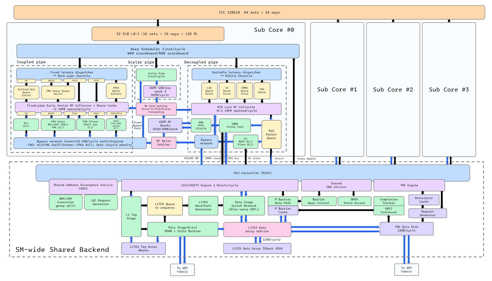
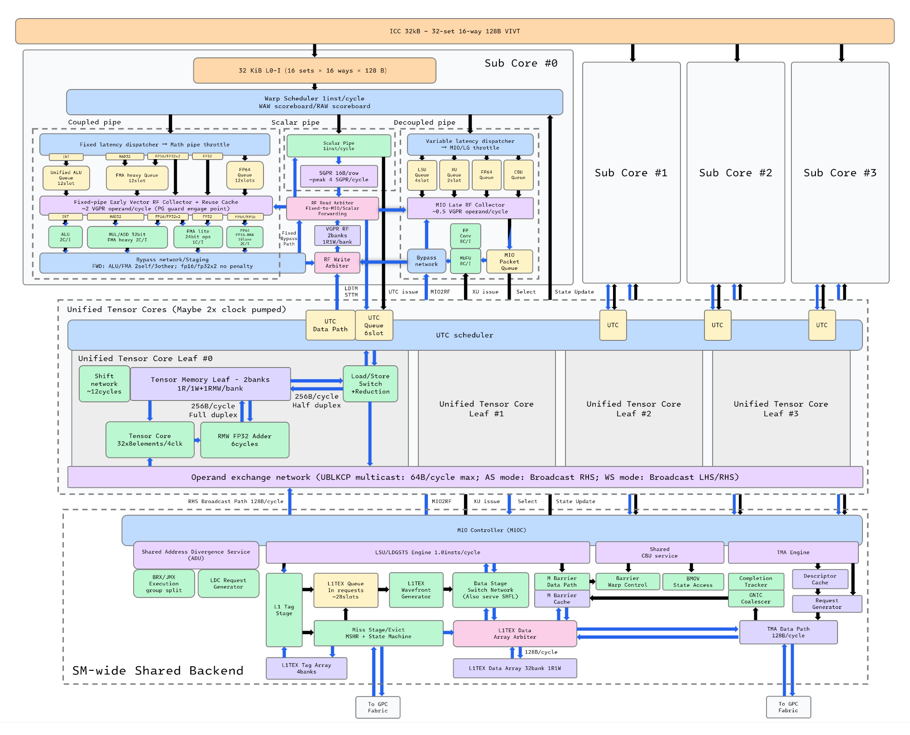

### NVIDIA异步Tensor Core解读

NVIDIA的两代专业卡Hopper和Blackwell都引入了异步Tensor Core矩阵乘法支持，本文面向算子开发者和可能的硬件架构研究者，基于手动构造的SASS探针对这两代硬件开展microbench，对Hopper GMMA和Blackwell UMMA可能的硬件实现进行推断，帮助读者更好地建立对应的硬件心智模型。以下Tensor Core操作若无特殊说明，默认均以bf16输入稠密模式为准。UMMA分析暂时局限于1CTA模式，后面有时间会继续补充。

文中的探测SASS均从仓库实际探针中抽取，只保留与被测资源有关的核心序列。为便于阅读，除非控制字本身是实验变量，否则省略每行末尾的调度bracket；`...`表示由生成器静态重复的同类指令，而不是可直接提交给assembler的字面语法。完整可运行版本列在文末实验索引中。

### 一、Hopper GMMA实现分析

Hopper引入的GMMA（Warp-Group MMA）相比于先前的WMMA（Warp MMA）引入了两点最明显的改动：1. 4个warp同时进行MMA操作，从小尺寸的m16n8k16变为大尺寸的m64n?k16，每个warp各自持有16行m16n?的累加结果；在公开PTX中，m16k16 operand（后面称lhs operand）可以来自每个warp的寄存器或直接来自shared memory，而n?k16 operand（后面称rhs operand）来自shared memory；2. MMA的完成变为异步，后续指令不需要等待MMA完成即可继续发射。后文还会看到，native SASS额外提供了PTX未公开的反向形式：lhs来自shared memory，rhs由每个warp的寄存器提供。根据ptx文档，典型的GMMA使用序列如下：

```
wgmma.fence.sync.aligned;
wgmma.mma_async.sync.aligned.m64n128k16.f32.bf16.bf16
    d, a_desc, b_desc, scale_d; # SS mode
wgmma.mma_async.sync.aligned.m64n128k16.f32.bf16.bf16
    d, {a}, b_desc, scale_d; # RS mode
wgmma.commit_group.sync.aligned;
wgmma.wait_group.sync.aligned 0;
```

以上基本是我们能从公开渠道直接获取的全部信息，下面我们将结合硬件行为进行更加深入的分析。

#### 1. 为什么需要GMMA

首先我们需要先对NVIDIA GPU有一些基础的了解。每个SM上有4个subcore，它们共享一个MIO controller及其后面连接的L1TEX系统，shared memory的储存体和L1共享，两者挂靠在L1TEX下面。shared memory有32个4bytes的bank，能提供128B/clk的读带宽。4个subcore每个能承载多个warp并在其中轮换执行，对shared memory的请求通过MIO controller仲裁。

接下来我们来做一些简单的换算：Ampere一代设计的每SM算力是1024MACs/clk，每个subcore有一个m16n8k16的Tensor Core，吞吐是8clk/inst，也即每个Tensor Core贡献256MACs/clk。Tensor Core的操作数通过LDSM指令（ptx ldmatrix）从shared memory装载到寄存器文件（RF）中，以利用矩阵乘法的局部性。印象中，shared memory作为片上SRAM应该是带宽很大的，但是现在我们来具体计算一下带宽需求。每个subcore上的warp负责$(16m,8n)$形状的累加tile，每步reduce掉16个k，需要周期数$16mn$，需要加载数据$(16m+8n)\cdot 16 \cdot 2=256(2m+n)$ bytes。4个subcore对shared memory均摊下来的总需求就是
$$
S=\frac{1024(2m+n)}{8nm}=64(\frac{2}{n}+\frac{1}{m}) \text{bytes/clk}
$$
而每个warp的线程需要的累加器寄存器量是$16m\cdot 8n/32=4mn$，每个warp寄存器上限255（实际上能用于累加器的只能到252），而进一步要防止spill一般会给累加器128个寄存器，有时可能能略多。用HM-GM不等式可以估计出$S$的下界
$$
S\ge \frac{512\sqrt{2}}{\sqrt{4mn}}\ge64\text{bytes/clk}
$$
这样一来$S$保底就是64B/clk，已经占了超过一半的shared memory带宽，而剩下的带宽还需要服务软流水线LDGSTS(ptx cp.async)的预取，同时调度也不保证shared memory每个周期都有效地活跃，因为subcore还需要做各种整数地址计算、边界检查以及额外工作，读流量很难保证稳定持续；而预取的写流量更加不规则，因为预取本来就是用来吸收访存延迟方差的。不过总体来看，在Ampere这一代，shared memory带宽一般还是够用的。

现在来到Hopper这一代，每SM算力需要翻倍。如果维持Ampere的模式，这样Tensor Core对shared memory的读带宽需求就是
$$
S=256(\frac{2}{n}+\frac{1}{m})\text{bytes/clk}
$$
这样实际上shared memory带宽已经非常危险了，在合理的累加器tile预算下，全速做MMA时shared memory将直接断流，预取也无法进行。问题的关键其实在于，shared memory经常要给4个subcore发同样的数据，但是这些同样的数据视累加tile大小的不同可能需要反复发2~4遍。基于这个观察，一个简单的想法就能解决问题：让shared memory送出一批数据时在4个subcore间广播，shared memory绝不多次送出重复的数据。这个视角下，GMMA的设计就变成，每个subcore依然保有m16n8k16规格的Tensor Core（虽然速率翻倍，吞吐4clk/inst），每个subcore先加载m16k16的lhs operand，不管是从RF来还是shared memory来，至少都不会有重复数据；而rhs operand被分成n8k16的小块，在4个subcore间广播，达成完全的数据复用，每个n8k16块只被shared memory送出1次。这样一来，读带宽
$$
S=\frac{64m\cdot 16+m\cdot 8n\cdot 16}{4mn}\cdot2=64+\frac{512}{n} \text{bytes/clk}
$$
这样只需要有一个足够大的$n$就可以将shared memory带宽压到相对安全的范围内，比如GEMM kernel会希望$n=16$，这样Tensor Core全速运行时均摊下来只需要占80bytes/clk的带宽，还有48bytes/clk的带宽能留给预取，在绝大多数情况下都能发挥出不错的性能。

#### 2. GMMA的ISA层描述与硬件实现

下面我们看GMMA在ISA层如何进行描述。在 Hopper 的真实 cubin 中，常见 lowering 是：

```sass
WARPGROUP.ARRIVE
@P0 HGMMA.64x32x16.F32 {R24,...,R39}, {R4,...,R7}, gdesc[UR8], RZ, !UPT
...
@P0 HGMMA.64x32x16.F32 {R24,...,R39}, {R8,...,R11}, gdesc[UR8], {R24,R25,...,R39}, UPT
...
@P0 HGMMA.64x32x16.F32 {R24,...,R39}, {R12,...,R15}, gdesc[UR8], {R24,R25,...,R39}, UPT, gsb0
WARPGROUP.DEPBAR.LE  gsb0, 0
```

这里先给不习惯阅读SASS的读者介绍一些前置芝士。形如Rxx的寄存器是向量寄存器，warp中的每个线程持有一个4bytes的值；形如URxx的寄存器是标量寄存器（或者一般叫Uniform register），每个warp持有一个4bytes的值；P开头的寄存器是向量谓词寄存器，每个线程持有一个bool值，PT固定为true；UP开头的寄存器是标量谓词寄存器，每个warp持有一个bool值，UPT固定为true。每个操作数可以由一系列编号连续对齐的寄存器拼接，每条指令的第一个操作数是它的目的操作数。gsb0是一个scoreboard counter，具体语义后续描述。

`WARPGROUP.ARRIVE`是`wgmma.fence.sync.aligned`的SASS lowering。静态规格表明它写入专用的`GMMA_SCOREBOARD`，后续HGMMA读取该scoreboard；它的核心语义是把此前对累加器寄存器和A fragment寄存器的普通RF访问，与之后的异步HGMMA访问排序。它同时属于BRU/barrier类路径，能够把warpgroup的四个warp带到一致的异步代理边界。不过这里不应再把它描述成“HGMMA开始执行所必需的四warp硬屏障”：手写SASS在H20上完全省略ARRIVE、甚至让warp 0先延迟约一万cycle，HGMMA仍能得到正确结果，说明HGMMA自己的issue路径也会完成必要的warpgroup配对。PTX层面仍必须遵守fence契约；硬件容忍非法/不规范SASS，不等于编程模型取消了该排序边界。

按PTX规定的合法序列跨过fence边界后，warpgroup就可以开始发射GMMA指令。这里以HGMMA为例；上面示例中的HGMMA是RS mode，也就是lhs operand来自寄存器。第一条指令

```
HGMMA.64x32x16.F32 {R24,...,R39}, {R4,...,R7}, gdesc[UR8], RZ, !UPT
```

中`{R24,...,R39}`是目的寄存器组。每个warp的累加器组的shape是$(16,32)$，也就是每个线程分到16个fp32值，对应R24...R39这16个寄存器，具体layout是每4个寄存器对应每个$(16,8)$大小的累加器组，参考Ampere m16n8k16的输出layout。`{R4,...,R7}`是lhs operand对应的寄存器组，也与Ampere的m16n8k16的layout约定相同。

这里特别澄清容易混淆的`gdesc`宽度。单个PTX shared-memory matrix descriptor是**64 bit，占两个连续且偶数对齐的UR**；它编码shared-memory起始地址、leading-dimension offset、stride-dimension offset、swizzle mode等信息。SS形式需要A和B两个descriptor，SASS把它们合成一个128-bit、4-UR对齐的复合源操作数：`{URn,URn+1}`是A descriptor，`{URn+2,URn+3}`是B descriptor。RS虽然只消费B descriptor，却保留了B在这个四UR槽位中的偏移，因此打印为`gdesc[URn]`时实际读取的是`{URn+2,URn+3}`；例如nvcc打印`gdesc[UR8]`，descriptor构造链最终写入的却是`UR10:UR11`。反向的SR变体直接从`{URn,URn+1}`读取A descriptor。cuobjdump通常把这些都简写成`gdesc[URn]`，所以不能从方括号里只出现一个UR误判descriptor只有32 bit，也不能把SS的4个UR误判为一个128-bit descriptor。仓库中的手写SASS已经逐bit复现了ptxas的descriptor构造链，确认硬件直接消费PTX规定的原始64-bit descriptor，并不存在额外的SASS级重打包。

| HGMMA形式 | A来源 | B来源 | `gdesc[URn]`实际消费的UR |
|---|---|---|---|
| SS | shared | shared | `{URn,URn+1}` = A，`{URn+2,URn+3}` = B，共4个UR |
| RS | 4个GPR/warp | shared | `{URn+2,URn+3}` = B；可见基址仍为`URn` |
| SR | shared | GPR | `{URn,URn+1}` = A，共2个UR |

**PTX未公开的SR形式。** Hopper的SASS规格中还存在`hgmma_URa_Rb_Rc_`（opcode `0x15f0`）：A由shared descriptor给出，B由GPR组给出。H100上的逐元素one-hot探针确认它不是占位编码，而是完整的
$$
D=A_{\rm shared}B_{\rm reg}+C
$$
运算。对BF16/FP16的m64n$N$k16，令$w=\lfloor tid/32\rfloor$、$lane=tid\bmod32$，$j$为B操作数中的第$j$个32-bit寄存器，$h\in\{0,1\}$为低/高16-bit半字，则该分量承载
$$
k=8(j\bmod2)+2(lane\bmod4)+h,\qquad
n=8\lfloor j/2\rfloor+\lfloor lane/4\rfloor.
$$
每线程使用$N/4$个寄存器，因此每个warp正好携带一份完整的$16\times N$ B tile。TF32的k维为8，每个寄存器只放一个元素，对应
$$
k=4(j\bmod2)+(lane\bmod4),\qquad
n=8\lfloor j/2\rfloor+\lfloor lane/4\rfloor.
$$
探针完整扫描了BF16、FP16和TF32的n8/n16形状，共3840个寄存器分量，没有发现空洞、别名或隐藏归约。

更关键的是，四个warp的寄存器B fragment彼此独立：warp $w$提供的$B_w$只影响输出行$16w\ldots16w+15$。所以SR的准确分解是
$$
D[16w:16w+16,:]=A[16w:16w+16,:]B_w+C[16w:16w+16,:].
$$
标准GEMM必须在四个warp中复制相同的B；如果四份B不同，就会得到四个16行分块各自使用不同权重矩阵的运算。这个行为在数据分工上类似四个warp分别取得自己的$16\times K$ A行块再执行MMA，但A并没有通过架构可见的LDSM进入GPR，整条指令仍遵守warpgroup级HGMMA的异步语义。

descriptor却不是per-warp输入。我们让四个warp的UR分别指向内容可区分的shared tile，并循环移动四份descriptor：SR的A descriptor和RS的B descriptor都只采用**warp 0**给出的值，随后供整个warpgroup使用，warp 1--3中的descriptor没有可见作用。于是两种寄存器/共享混合形式可以统一写成
$$
\begin{aligned}
\text{SR: }D_w&=A_0^{(w)}B_w+C_w,\\
\text{RS: }D_w&=A_wB_0+C_w,
\end{aligned}
$$
其中下标0表示descriptor由warp 0提供，$A_0^{(w)}$表示该warpgroup级A tile中属于warp $w$的16行。这也给前面的shared广播模型补上了直接证据：shared操作数在warpgroup范围内选定并复用，而GPR矩阵fragment保留per-warp所有权。

`RZ`项对应累加器的初值，`RZ`是零寄存器，写入无效而读出恒为0。最后一项`!UPT`是是否使用累加器初值，这里恒为假代表从零开始累加。

后面的HGMMA指令语义类似，而最后一条带有gsb0，也即

```
@P0 HGMMA.64x32x16.F32 {R24,...,R39}, {R12,...,R15}, gdesc[UR8], {R24,R25,...,R39}, UPT, gsb0
```

这里的意思是，将自身和上面所有还没带gsb0的GMMA指令打包成一个completion group进行记账，然后给gsb0这个scoreboard counter加一。等到整个completion group完成后，gsb0减一，这时可以安全释放引用的shared memory位置并获取累加寄存器的值。所以`wgmma.commit_group.sync.aligned;`并没有一条自己的指令，而是在先前出现的GMMA指令中找到最后一条，给它标上gsb0标志。

最后一条指令是

```
WARPGROUP.DEPBAR.LE  gsb0, 0
```

该条指令将监控gsb0 counter的值，后面的操作数0代表阈值$T$，当$\text{gsb0}\le T$时等待结束，warp scheduler可以继续该warp，否则等待。这条指令对应了`wgmma.wait_group.sync.aligned 0; # T = 0`，而通过调整$T$可以在还有outstanding的GMMA completion group时就提前结束等待，通过这个特性可以排一些软流水线。不过值得注意的是，ptxas在non-trivial CFG下对等待安全的分析相当保守，容易误认为程序在等待不足时就读取了累加器、发出警告并插入不必要的强制同步，因此这个特性并不总是好用。

下面进入硬件实现的推断。在H100的SM微架构中，GMMA属于MIO_SLOW_OPS，走的是MIO dispatch路径。



这边再给对NVIDIA GPU微架构不太熟悉的读者介绍一些前置芝士。subcore内部的向量管线主要有两条，其中标注Coupled pipe的是固定延迟向量管线，大部分整数和浮点算术指令都在这里执行，Ampere的Tensor Core WMMA指令也在固定延迟管线中。而另一条是Decoupled pipe是可变延迟向量管线，包括访存、SFU和GMMA，它们基本归属MIO（Memory I/O）指令族。整个SM有一个4subcore共享的MIOC（MIO controller）在4个subcore间公平调度。

从上面的图可以看到，GMMA有一个自己的Admission queue，后文会说明其实测有效深度约为7。MIOC调度GMMA指令后，GMMA指令会进入MIO侧的Late RF Collector来捕获来自RF的lhs operand（RS模式下是这样），然后进入Tensor Core执行。shared-memory操作数读取则在普通LDS前端队列之后汇入共享数据交换路径，并以很高优先级获得服务；后文的竞争实验能精确数出每条HGMMA占用的128-byte wavefront数。这里应避免把整条路径笼统称为“走LSU”：HGMMA拥有独立的`$VQ_UMMA`（是的，内部它居然叫UMMA）和command FIFO，普通LDS/STS队列的拥塞不会反向拖慢HGMMA admission，但HGMMA会在更下游的shared-array/data-exchange仲裁点挤压LDS、STS、LDSM和SHFL。

GMMA处理累加旧值的方式也不是在指令admission时一次性捕获整个累加器。实测表明，每条HGMMA携带自己的增量$\delta=A\times B$穿过流水线，并在完成端对每个目的寄存器执行`RF := RF_now + delta`；overwrite形式则直接写入$A\times B$。在完成窗口中插入普通寄存器写，可以稳定观察到`marker+delta`、`base+delta`和`marker`三种相位，其中单个寄存器对的read-before-write窗口约为12 cycle。Hopper RF仍按奇偶寄存器分bank，每bank可见一个普通写入service；HGMMA结果提交会与普通GPR写流竞争，说明它没有完全独立于RF的最终写口。另一方面，旧累加值的读取不走普通ALU的多源collector，更符合专用RMW读路径或bank-local RMW。换言之，实验支持“异步、分阶段的RF RMW”，不支持“整个K-loop的累加器长期只存在于一个隐藏collector、直到wait才一次性drain”的旧模型。

#### 3. 关于GMMA 执行速率的探测

首先区分三个经常被混在一起的量：前端把HGMMA送进command FIFO的admission速度、Tensor Core处理一条指令的稳态速度，以及`DEPBAR`看到的端到端完成延迟。短burst可以以前端1条/cycle左右的速度快速灌入FIFO，但这既不是计算吞吐，也不是单条延迟。

在全速GH100（H800 PCIe）上，BF16 SS形式的实测结果如下。64条链中，m64n8、n16、n64的稳态issue间隔约为17.4、19.2、30.4 cycle，连同尾部`DEPBAR`折算则约为19.4、21.6、34.3 cycle/MMA；单条指令从发射到`WARPGROUP.DEPBAR`结束约为53、57、81 cycle。更长的实用shape中，m64n128k16的单accumulator链约67.4 cycle/MMA，对应约1944 MAC/cycle/SM。这个值已经接近单条依赖链能够利用的计算端上限，但仍低于大矩阵cuBLAS测得的整SM约2286 MAC/cycle，后者还能利用更宽shape与更多独立工作。

shape sweep给出了很重要的分界：n8到n64时，每条指令的shared-memory操作数字节数和执行时间近似同比增加，折算约112 B/cycle/SM，说明窄shape首先受操作数输送限制；到n128时字节吞吐反而下降，而MAC吞吐升到约1944 MAC/cycle/SM，此时才逐渐靠近计算端限制。因此“窄N指令更小，所以一定更快”只对单条延迟成立，对峰值利用率恰好相反。实际GEMM倾向n128/n256，是因为更宽的N显著提高了每字节shared-memory输入所完成的MAC数。

H20是同一代但Tensor Core吞吐被削减的很有价值的对照。其m64n16k16约32.4 cycle/MMA，约506 MAC/cycle/SM，已经打满H20的BF16 Tensor Core规格；m64n64k16约128.7 cycle，正好是4倍。FP8 QGMMA将K从16变为32，操作数字节数保持相同而MAC数翻倍，执行周期与BF16 HGMMA基本一致，得到约两倍的MAC吞吐。这些对照说明Hopper流水线的瓶颈不是一个固定“每条HGMMA多少cycle”的常数，而是shared操作数服务、Tensor Core计算能力、完成端RF提交三者的最大值。

**探针构造与核心SASS。** 吞吐探针只保留一个128-thread warpgroup，先用STS把A/B tile实际写入shared memory，避免ptxas把读取未定义shared memory的WGMMA当死代码删除。第一条MMA使用overwrite，后续MMA对同一累加器做RMW，只有尾指令写`gsb0`。两个时钟分别包围issue burst和真正的completion wait：

```sass
BAR.SYNC 0
WARPGROUP.ARRIVE
CS2R {R18,R19}, SR_CLOCKLO                   # t0
HGMMA.64x16x16.F32.BF16 {R24,...,R31}, gdesc[UR4], RZ, !UPT
HGMMA.64x16x16.F32.BF16 {R24,...,R31}, gdesc[UR4], {R24,...,R31}, UPT
...                                          # K条，静态展开
HGMMA.64x16x16.F32.BF16 {R24,...,R31}, gdesc[UR4], {R24,...,R31}, UPT, gsb0
CS2R {R20,R21}, SR_CLOCKLO                   # t_issue
WARPGROUP.DEPBAR.LE gsb0, 0
CS2R {R22,R23}, SR_CLOCKLO                   # t_done
```

**测试协议与判据。** 对N=8/16/32/64/128/256分别扫描K=1、16、32、64、128，核对最终SASS中的HGMMA条数而不是相信CUDA源码循环次数；每个配置先warm up，再取多次launch的中位数。`t_issue-t0`给前端加backpressure后的issue span，`t_done-t0`包含尾部完成；对K做线性拟合，斜率是稳态cycle/MMA，截距吸收ARRIVE、CS2R和DEPBAR固定成本。输入填BF16 1.0，最终结果还必须等于`16*K`，以排除“计时正常但MMA被DCE或descriptor读错”的假阳性。H20和H800运行完全相同的cubin构造，shape随N线性而设备间分叉，才用于区分计算端限制和shared operand限制。

#### 4. 关于GMMA Admission Queue深度及组织方式的探测

短burst探针在每条HGMMA前后读取时钟，并把控制字stall从4逐步缩短到1。stall=4时前7条HGMMA都只增加4 cycle，第8条开始明显等待；stall=2时有6条快速进入，stall=1时有4条快速进入，但所有曲线的拐点都落在累计6--8个admission附近。稳态时`drain_time-issue_time`约100 cycle，除以RS窄shape约13 cycle/条，也得到7--8条in-flight。三种测法一致，因此最简模型是**一个SM共享、有效深度约7条的TC command FIFO**。

这个FIFO按“指令条目”而不是tile字节计数：n8、n16、n64的拐点几乎不动，同一累加器链和8个累加器round-robin也没有区别。谓词恒假的HGMMA同样占用条目并以约13 cycle/条退出，说明command-path本身存在不可忽略的处理成本。两个warpgroup同时灌入时，每边只能快速进入约3条，第4条开始backpressure，稳态斜率约翻倍为26 cycle/条，进一步说明它们共享同一组约7个entry，而不是每个warpgroup各有一份队列。

FIFO满时的行为只是让发射warp停在入口等待，不会丢失计算或覆盖旧命令。普通LDS、SHFL、MUFU甚至已在运行的LDG flood都不改变拐点，也几乎不改变HGMMA自己的发射与完成时间，所以这个队列并非普通LSU/XU队列的一个分区，而是`$VQ_UMMA`对应的独立资源。

**探针构造与核心SASS。** Admission实验不用长链拟合，而是把burst长度$K$从0逐条增加到24，并分别保存burst前、burst后、DEPBAR后的时钟。每条HGMMA的schedule stall可切换为1/2/4；另一个版本用恒假的`@P6`保留command admission而消除真实operand/compute/writeback：

```sass
WARPGROUP.ARRIVE
CS2R {R18,R19}, SR_CLOCKLO
@P6 HGMMA.64x16x16.F32.BF16 {R24,...,R31},
     {R56,R57,R58,R59}, gdesc[UR8], RZ, !UPT       # 可换成active
...                                                 # K条
CS2R {R20,R21}, SR_CLOCKLO
WARPGROUP.DEPBAR.LE gsb0, 0                         # active版本
CS2R {R22,R23}, SR_CLOCKLO
```

**测试协议与判据。** 分别测RS/SS、active/predicated-off、stall=1/2/4以及1/2个warpgroup；每点重复7次取中位数。若没有FIFO，`t_issue(K)`应从第一条起按steady drain rate线性增长；若有深度为$Q$的FIFO，则前$Q$条只付静态stall，第$Q+1$条出现斜率折点。两warpgroup实验使用256-thread CTA，若队列per-warpgroup，双方应各保留完整窗口；实测窗口各约减半且总entry数不变，因此归为SM共享资源。谓词关闭仍有同一折点，排除了累加器RAW、shared流量和RF写回造成“伪队列深度”的可能。

#### 5. 关于GMMA的LHS operand collect路径的探测

RS形式中，每个warp用4个GPR提供m16k16的A fragment；四个warp合起来构成m64k16的A。问题是这些GPR到底从固定延迟ALU collector读取，还是从MIO侧late collector读取。竞争实验给出了定量答案。

用三个新鲜源寄存器的FFMA只读storm把固定管线的banked collector压满时，RS与SS HGMMA增加的时间完全相同；如果RS的四个A寄存器也走这里，它理应比SS多出明显惩罚。相反，让目标为RZ的SHFL分别读取普通GPR和RZ时，只有RS形式对“读取普通GPR”的SHFL额外增加约2.2--2.5 cycle/HGMMA，SS没有这个差值。四个A寄存器乘以已知late collector约0.55 cycle/operand，恰好闭合。因此可以确定：**RS的A fragment由MIO late GPR collector收集，而不是ALU固定管线collector**，并且HGMMA在该collector的仲裁优先级高于普通SHFL/MUFU一类操作。

RS去掉了A的shared-memory读取，单条n16/n32完成延迟比SS短约18 cycle，短burst也快约30%；但长链吞吐通常只与SS持平甚至略差，因为此时转而受command path、A staging和RF完成端约束。ptxas还会在超过约32条in-flight RS MMA时给出C7511并主动串行化，分成不超过16或32条的commit/wait批次可恢复吞吐。实际代码应把RS理解为“用RF压力换A的shared读取”，而不是无条件更快的模式。

**探针构造与核心SASS。** 一个256-thread CTA被分成两个warpgroup。warpgroup 0发RS或SS HGMMA；warpgroup 1的四个warp覆盖四个subcore，发射可选择的collector contender。固定管线压力使用三个轮换新鲜源且目的为RZ的FFMA；late collector压力使用只改变源是否为GPR的SHFL：

```sass
# warpgroup 0
HGMMA.64x16x16.F32.BF16 {R24,...,R31},
    {R56,R57,R58,R59}, gdesc[UR8], {R24,...,R31}, UPT, gsb0  # RS

# warpgroup 1，固定collector control
FFMA RZ, R64, R79, R90
FFMA RZ, R66, R81, R92                         # 30组源轮换，不允许reuse

# warpgroup 1，late-collector差分对
SHFL.BFLY PT, RZ, R40, 0x1, 0x1f              # 真实GPR源
SHFL.BFLY PT, RZ, RZ,  0x1, 0x1f              # RZ源control
```

**测试协议与判据。** 四种工作负载`HGMMA-only`、`contender-only`、`overlay`、`predicated-off HGMMA + contender`保持相同CTA大小和控制流，每一侧独立用CS2R计时。SS是“不读A GPR”的负对照；RS与SS在FFMA读storm下若增量相同，排除fixed collector。再计算`SHFL(GPR)-SHFL(RZ)`：差值只在RS出现，并乘以contender/HGMMA条数比还原为每条MMA约2.2--2.5 cycle；该值与4个A GPR乘late-collector单operand代价吻合。HGMMA侧计时始终不变，则说明仲裁优先级是HGMMA赢、SHFL等待，而非双向互相阻塞。

#### 6. 关于GMMA与shared-memory/LSU相互作用的探测

BF16 m64nNk16 SS形式的操作数流量可以逐wavefront计算。A固定为$64\times16\times2=2048$ B，也就是16个128-B wavefront；B每增加n8需要$16\times8\times2=256$ B，也就是2个wavefront。因此

$$
W_{SS}=16+2\frac{N}{8},\qquad W_{RS}=2\frac{N}{8}.
$$

用长STS流充当shared-data arbiter占用计，n8/n16/n64的SS实测阻塞分别为18.26、20.13、32.13 cycle/HGMMA，对应理论18、20、32；RS实测为2.11、4.22、16.11，对应理论2、4、16。误差已经小到可以把后端描述成**每cycle服务一个128-B shared wavefront**。RS恰好去掉固定的16个A wavefront，B流量完全保留。

竞争方向高度不对称：活跃HGMMA几乎不被LDS、STS、LDSM、SHFL拖慢，但这些普通操作会被HGMMA拖慢。以n16长流为例，H800上LDS从4.12增至6.63 cycle/inst，LDSM从15.74增至18.24，STS从15.76增至18.27；把HGMMA谓词关掉后大部分惩罚消失。一个32-wavefront的重LDS本身比broadcast LDS慢约120 cycle，但HGMMA额外造成的增量仍约2.5 cycle/inst，说明HGMMA没有占用LDS wavefront queue本身，而是在队列之后的shared-data/exchange仲裁点优先取走service slot。

同样的现象也解释了为什么HGMMA会影响TMA的shared读侧，却不能简单说两者“共用LSU”。独立command queue、单向的优先级和精确的wavefront守恒，支持的最小拓扑是：TC命令先进入独立FIFO，descriptor reader随后在shared array/data-exchange后端与普通MIO流量会合；仲裁优先保证Tensor Core连续供数，把延迟回灌给普通请求。

**探针构造与核心SASS。** 仍使用两个warpgroup：warpgroup 0发64条HGMMA，warpgroup 1的四个warp发512条同类contender，使每个subcore都有一条独立流。STS是最干净的占用计，因为它没有destination RF writeback；LDS/SHFL/LDSM用于定位竞争发生在前队列还是shared exchange后端：

```sass
# warpgroup 0：SS或RS，尾部commit/wait
HGMMA.64x16x16.F32.BF16 {R24,...,R31}, gdesc[UR4], {R24,...,R31}, UPT
...
HGMMA.64x16x16.F32.BF16 {R24,...,R31}, gdesc[UR4], {R24,...,R31}, UPT, gsb0
WARPGROUP.DEPBAR.LE gsb0, 0

# warpgroup 1：四warp同时执行同一contender stream
STS [R43], R40                                   # occupancy meter
# 或 LDS RZ,[RZ] / LDS R64,[RZ]
# 或 SHFL.BFLY PT,RZ,RZ,0x1,0x1f / LDSM.16.M88.4 ...
```

**测试协议与判据。** 对每种指令运行`solo_h`、`solo_c`、`overlay`和`pred_h`四组，双方各自记录CS2R起止时间。HGMMA造成的总阻塞按

$$
B_{\mathrm{per\ MMA}}=(C_{overlay}-C_{solo})\frac{N_c}{N_h}
$$

还原，其中$N_h=64$、$N_c=512$。再分别切换SS/RS和N=8/16/64，与理论$W_{SS}$、$W_{RS}$逐项比较。32-wavefront LDS与broadcast LDS具有完全不同的solo成本，却得到近似相同的HGMMA增量，说明竞争不在LDS请求/wavefront queue；HGMMA自身在所有overlay中不变且predicated-off control只解释少量调度开销，才据此把交点放在后端shared-data arbiter，并判断tensor请求优先。

#### 7. 关于GMMA累加写回方式、累加延迟与RF规格的探测

最关键的判别实验是在两条HGMMA尚未完成时，用`MOV32I`覆写其累加器。如果旧累加值在issue时被整体捕获，最终结果应忽略中途写入；如果中间结果长期留在隐藏collector，行为也应受commit/drain边界控制。实际结果却稳定为`MOV32I_value + sum(all AB deltas)`：普通写先落到RF，随后每条HGMMA在各自完成时读取当时的RF值并做加法RMW。把overwrite放在第一条MMA之后、`DEPBAR`之前还能得到逐寄存器撕裂的混合结果，进一步证明写回是渐进发生的。

这个模型还解释了几组负结果：不带`gsb0`的HGMMA照样会在完成时写回；`gsb0`前后没有flush或retire状态；连续128个commit、28个独立累加器、交错切换多个累加器都没有容量或正确性问题。`gsb0`只是completion counter，只有带`gsb0`封闭的group才会被`DEPBAR`计数，`DEPBAR.LE gsb0,N`按严格issue顺序保证最老的group已经完成。它等待的是最后一个寄存器写回完成，而不是触发写回。

单条m64n16/n64/n256的完成时间约为57/81/177 cycle，可近似写成约49 cycle固定开销加每个FP32目的寄存器约1 cycle的串行完成分量。用普通GPR写入storm与HGMMA叠加，n8/n16/n64每条MMA分别多出约1.88/3.89/15.69 cycle，正比于4/8/32个目的寄存器；overwrite和RMW形式完全相同。这说明最终提交与普通RF的每bank 1W域仲裁。直接的marker race则观察到单个偶/奇寄存器对约12 cycle的read-before-write窗口，并且从低寄存器对扫到高寄存器对时边界按约每对2 cycle平移。不过“最终要仲裁RF写口”不等于“所有消费者只能等RF”：下面的同一寄存器双读探针表明，SHFL/MUFU一侧能比INT/FMA collector约早4 cycle取得HGMMA结果。

需要强调，普通读storm没有发现“每个累加寄存器都从ALU 2R collector读取”的开销。旧D值也不走RS A-fragment所使用的MIO late-GPR collector：补充对照让64条n64 SS HGMMA在全RMW与全overwrite之间切换，同时由另一warpgroup的四个warp各发512条`SHFL RZ,R40`，并用`SHFL RZ,RZ`扣除非RF部分。RMW下两者为8.162与8.160 cycle/SHFL，全overwrite得到完全相同的数；HGMMA issue/drain也逐项相同。若每条n64 RMW的32个旧D都经过late collector，RMW相对overwrite必然增加可见占用，而不是小于0.01 cycle的零差分。因此旧D读应通过专用accumulator-read或bank-local RMW路径；这与“完成后的新结果可向MIO消费者forward”是相反方向的两件事，不能混同。最终结果仍要进入普通RF写入域。这个局部RMW结构既解释了异步写回，也解释了为什么`WARPGROUP.ARRIVE`必须在普通指令重写accumulator/A-fragment之后建立异步代理排序。纯HGMMA之间切换累加器不需要额外fence；真正需要`DEPBAR + ARRIVE`的是epilogue读取、重新初始化、spill等非HGMMA RF访问。实验中每次切换都过度fence会把20.6 cycle/MMA拉到40.4 cycle/MMA，几乎减半吞吐。

**探针一：中途覆写判定late RMW。** 先把n64累加器全部初始化为1.0，发一条accumulate HGMMA，然后用可调数量的stall-1 NOP把普通marker写扫过完成窗口。这里故意在`DEPBAR`前制造数据竞争，只用于微架构判别：

```sass
MOV32I R24, 0x3f800000                         # base = 1.0
...                                            # R24..R55全部初始化
WARPGROUP.ARRIVE
HGMMA.64x64x16.F32.BF16 {R24,...,R55},
    gdesc[UR4], {R24,...,R55}, UPT, gsb0       # delta = 16.0
NOP                                            # 重复d次，扫描相位
MOV32I R24, 0x40000000                         # marker = 2.0
WARPGROUP.DEPBAR.LE gsb0, 0
STG.E [out], R24
```

若marker在HGMMA读取旧D之前落地，结果为18；若落在read和write之间，HGMMA最终写17；若落在HGMMA写回之后，结果为2。连续扫描$d$得到`18 -> 17 -> 2`三个稳定区间，17区间就是read-before-write窗口。把目标从`{R24,R25}`逐对移到`{R54,R55}`并对偶/奇bank分别重复，用边界平移估计每对约2 cycle、局部窗口约12 cycle。

**探针二：RF端口竞争。** CTA的前四个warp组成warpgroup，连续发64条dependent SS HGMMA；其余四个warp各自发无GPR源的`MOV32I`写storm。真实目标和`RZ`版本具有相同的指令、调度和立即数生成压力，差别只剩架构RF写入：

```sass
# hpath: warp 0..3
WARPGROUP.ARRIVE
HGMMA.64x8x16.F32.BF16 {R24,R25,R26,R27},
    gdesc[UR4], {R24,R25,R26,R27}, UPT, gsb0
...                                             # 共64条
WARPGROUP.DEPBAR.LE gsb0, 0

# cpath: warp 4..7；control把R64换成RZ
MOV32I R64, 0x12345678
MOV32I R66, 0x12345678
...                                             # 固定奇偶目标并循环
```

协议分别测contender solo、`MOV32I RZ` overlay和real-GPR overlay，记录两边`CS2R SR_CLOCKLO`包围的issue窗口；对n8/n16/n64按64条HGMMA归一，并交换全偶、全奇和平衡目标。real-GPR相对`RZ`的惩罚为1.875/3.891/15.687 cycle/MMA，随4/8/32个目的寄存器成比例，且contender自身也被反压；overwrite和RMW相同，从而把竞争定位到最终RF write commit而非旧D读取。全偶、全奇和平衡storm的总惩罚相同，因为每个合法HGMMA accumulator组都同时覆盖两个bank。另一个“偶/奇目标 × 偶/奇writer”的单字WAW边界探针没有观察到对角移动：依赖/forwarding排序掩盖了物理commit时刻，因此不能用它进一步定位写口mux。

**探针三：MIO侧是否先于普通RF读可见。** 先把n64 overwrite HGMMA的尾部累加器`R54`设为4.0；A/B全为1，所以新结果严格为16.0。HGMMA后不做`DEPBAR`，而用$d$条stall-1 NOP扫描四种无等待消费者。消费者结果由自身scoreboard保护，随后才等待`gsb0`并存储，因此分类的是消费者先前锁存的值，而不是STG的晚取数：

```sass
MOV32I R54, 0x40800000                       # old = 4.0
WARPGROUP.ARRIVE
HGMMA.64x64x16.F32.BF16 {R24,...,R55},
    gdesc[UR4], RZ, !UPT, gsb0                # overwrite => 16.0
NOP                                           # 重复d次；stall=1
SHFL.IDX PT, R60, R54, RZ, 0x1f              # 或MUFU.RCP
# 对照：IADD3 R60,R54,RZ,RZ / FADD R60,R54,RZ
WARPGROUP.DEPBAR.LE gsb0, 0
STG.E [out], R60                              # 等消费者自己的SB
```

20次launch、每次128 lane的结果完全重复：INT与FADD在$d=34$仍全旧、$d=35$起全新；SHFL在$d=32$恰好64 lane旧/64 lane新，$d=33$起全新，MUFU同样在$d=33$起全新。已知stall-1 NOP流约为2.003 cycle/条，所以表面领先约4 cycle。为排除“两个独立kernel的issue相位不同”以及“SHFL只是晚锁存源”这两个替代解释，又在**同一条动态指令流**中先发MIO消费者、下一条立即发普通collector，二者读同一个`R54`：

```sass
# d = 33，无任何HGMMA wait
SHFL.IDX PT, R60, R54, RZ, 0x1f              # wr=SB1
IADD3       R61, R54, RZ, RZ                 # wr=SB2；程序次序更晚
# 另一组为 MUFU.RCP R60,R54；FADD R61,R54,RZ
WARPGROUP.DEPBAR.LE gsb0, 0
STG.E [out_mio], R60                          # req SB1
STG.E [out_fixed], R61                        # req SB2
```

在$d=33$，SHFL→IADD3与MUFU→FADD均得到`fresh/stale = 2560/2560`；$d=31$均为`stale/stale`，$d=34$均为`fresh/fresh`。也就是说，程序次序更早的MIO/XU消费者已经拿到16.0时，下一条普通INT/FMA读仍只能从RF读到4.0。若两者都直接读取一个单调更新的架构RF，这个`fresh -> stale`次序不可能出现；因此HGMMA完成端确实向MIO/XU消费侧提供了RF commit之前的forward/bypass。反向控制（先发SHFL/MUFU，再立刻用MOV覆写已就绪源）在零间隔就稳定锁存旧值，排除了一个无条件的“发射后固定晚两格读源”模型。

这个结论与探针二并不冲突：**HGMMA结果有早期MIO/XU bypass，但最终架构化仍参加普通per-bank RF写回仲裁**。实验能证明一条逻辑forward path，不能仅凭约4 cycle窗口确定它是独立物理总线、completion-buffer snoop，还是bank-local write-queue forwarding。

**协议完整性对照。** 所有合法结果读取都放在`DEPBAR`之后；只有上述race probe有意提前写/读。另做`no-gsb`、tail-gsb、每条都gsb、1--28个累加器round-robin和最多128条commit的矩阵，最终统一commit/wait并用受scoreboard保护的STG写回。早期所谓“约35组容量”正是因为深STG在数据寄存器重用后才late-read；给STG分配read scoreboard并在重写前`DEPBAR`后现象消失，因此不进入最终模型。

#### 8. 小结

Hopper GMMA不是简单把四条HMMA拼成一条指令。它引入了warpgroup级的异步代理语义、独立的约7-entry command FIFO、descriptor驱动的shared operand reader和专用group scoreboard；执行端仍按四个subcore分担m64输出，其中B tile只需从shared读取一次并跨subcore复用。完成端把每条MMA的$A\times B$增量异步地RMW进架构RF，`wait_group`只负责等待，不负责“把隐藏累加器搬回RF”。结果在最终RF commit前还能通过MIO/XU侧forward path被SHFL/MUFU观察到；最终提交本身仍与普通算术写回共享per-bank仲裁。

对算子作者最直接的建议是：窄N容易受shared operand path限制；长SS链通常比RS更稳妥；用尽量少的commit group覆盖足够多的连续MMA，但要在任何普通RF消费者之前真正commit并wait；只在跨异步代理的寄存器访问边界放`wgmma.fence`，不要在纯MMA累加器切换之间滥用同步。


### 二、Blackwell UMMA实现分析

#### 1. 为什么又需要UMMA

上一代Hopper通过引入rhs operand的广播解决了每SM算力2048MACs/clk下shared memory带宽不足的问题。而到了Blackwell这一代，每SM算力要求再次翻倍，达到4096MACs/clk水平。这个算力水平下，为了不再把刚刚解决的shared memory带宽问题再请回来，合理的做法只有缩放与rhs operand无关的维度即m维度。因此Blackwell将每warp的Tensor Core primitive变成了m32n8k16，shared memory带宽需求几乎与Hopper相同。然而接下来的问题变成了累加器写回带宽：一个m32n8k16矩阵乘法操作只需要4cycle，也就是4cycle内需要写回$(32,8)$大小的fp32值，也就是对RF的写回带宽达到了256bytes/clk。我们知道Volta及以后的架构，RF总是奇偶两个bank，每bank提供128bytes/clk的写回带宽，这样以来Tensor Core全速运行时就足以把RF写回带宽全部占满。除此之外，根据之前的分析，GMMA需要尽可能拉大n来摊掉lhs operand的读取开销，而RF累加器在指令编码上要求连续的寄存器号，因此Hopper kernel还经常面临GMMA累加器占用连续寄存器号导致的寄存器分配问题和意外的spill。

因此，Blackwell要实现标称的每SM算力，就需要提供更大的累加器读写带宽。相比于把pre-Volta的4bank RF请回来然后再苦一苦ptxas组，NVIDIA选择了将RF复制一份专门给Tensor Core使用，并起一个新的名字：Tensor Memory（TMEM）。我们知道每warp有32线程，而每个向量寄存器是32x4bytes，因此每个RF可以看成32行512列的array（每subcore有512个物理向量寄存器可以分配给所有的warp）。既然现在每warp/subcore的Tensor Core primitive变成了m32n8k16，最自然的组织方式，就是直接拿RF（现在该叫TMEM了）的32行对应m方向的32行，而每次MMA写回8列。这直接解释了每subcore持有私有的32行512列TMEM。

现在累加器写回带宽的问题解决了，Hopper的GMMA总是需要4个subcore在`WARPGROUP.ARRIVE`处同步，而同步就会产生bubble，需要看每个warp scheduler究竟什么时候调度到自己的那一条`WARPGROUP.ARRIVE`，仅仅是为了让Tensor Core连锁工作。现在既然累加器搬出了RF成为了独立的TMEM，不如更进一步让Tensor Core也搬出来，在控制上不再隶属于每个subcore而是在整个SM范围内统一调度。同时，由于没有operand走向量RF路径了，Tensor Core也没有理由要一整个warp发射了，因此Blackwell选择让Tensor Core指令并入标量管线（Uniform Datapath）形成Unified Tensor Core（UTC），这样一来一条指令就能启动整个SM级的Tensor Core而无需再让subcore进行没有必要的同步。修改到这一步，我们已经基本得到了Blackwell的UMMA。

#### 2. UMMA的ISA层描述与硬件实现



##### a. TMEM管理指令与协议

Blackwell把累加器从RF移到显式的Tensor Memory（TMEM），一个CTA可见512列TMEM，分配单位为“32列乘全部row”；`tcgen05.alloc`的普通形式接受32-512列且必须是2的幂。分配结果是一个32-bit TMEM column address（实际上试过就会知道，所谓column address就是0-511的整数，看上去完全就是RF的register id的形式），ptxas通常先把它写入shared memory，再由参与warp读取。对应的释放序列是`tcgen05.dealloc`，最后还必须执行`tcgen05.relinquish_alloc_permit`归还SM pool permit。

下降到SASS级别，SASS里没有一条直接叫ALLOC的硬件指令。ptxas用`UTCATOMSWS.FIND_AND_SET.ALIGN`原子更新一个由硬件维护的software-state allocator以实现快速的空闲区域查找，失败时用`NANOSLEEP`退避并重试；成功后将slot index乘32得到TMEM列地址，并在reserved shared memory中登记allocation mask。释放时用`UTCATOMSWS.AND`清除hardware state，同时清除reserved-shared中的镜像mask。这个协议解释了为什么alloc是warp-synchronous collective，而实际状态更新由一个elected participant完成。

TMEM kernel还有一层不可忽略的ABI。cubin必须携带`AT_ENTRY_FRAGMENT_TMEM_CTA1`或`AT_ENTRY_FRAGMENT_TMEM_CTA1_V2`元数据、reserved-shared符号和TCGEN05使用标记；driver会在用户入口前动态拼接entry fragment，初始化allocator bookkeeping并安装`ATEXIT_PC` handler。若kernel带着未释放的allocation到达EXIT，handler会清除泄漏的allocator bit并报告/触发协议错误；它是泄漏保护，不是省略dealloc的许可。CUDA 13.1/13.4的V2 fragment把reserved shared从0x54扩为0x60 byte，并改变内部partition布局，因此不能只替换一个枚举值混用V1/V2 lowering。

PTX ISA 9.4新增的`.exclusive`允许任意32列倍数，不过仓库在B200和B300上确认CUDA 13.4 ptxas存在后端bug：它忽略请求的`nCols`，恒按512列生成allocation mask。这个结果属于工具链缺陷，不应被误解成硬件allocator只能整块分配。

##### b. TMEM组织方式与读写路径

我们之前说过，每个subcore有一份自己私有的TMEM，形成四个32-row chunk。地址的低层抽象是column：`LDTM/STTM .32x32b.xN`由一个warp collective在每个lane和连续N列之间搬运数据，每条指令传输$32\times4\times N=128N$ byte。四个chunk可以并行服务，没有可见的SM-wide串行瓶颈。

普通LDTM与STTM走UDP侧的`$VQ_TMEM`，不走普通MIO/LSU queue。单warp `.x16`受fence和outstanding不足影响，LDTM/STTM直接测到约184/214 B/cycle/chunk；每chunk放两个warp后分别达到约237/249 B/cycle，四个chunk合计约948/995 B/cycle/SM。更强的同chunk双向实验表明LDTM与STTM共享一条约**256 B/cycle/chunk**的ordinary bidirectional service path，而不是各自拥有独立的256-B/cycle全双工口。

列对齐实验给出了service beat粒度：两个warp同时做`.x4`时，起始列0、2、4约需2.09 cycle/store，起始列1、3约需3.01 cycle/store。最小解释是**两列即256 byte为一个service beat**：偶数列开始的x4正好覆盖两个beat，奇数列开始则跨三个。虽然这个结论定位的是LDTM/STTM packing/ingress服务粒度，不足以直接宣称TMEM SRAM本体就是两列一个physical bank，但是种种迹象表明，它几乎保留了从RF移植而来的奇偶2bank设计，每bank提供128bytes/cycle带宽。

此外还有两条绕过ordinary path的逻辑入口。`UTCCP`把shared matrix异步拷贝到TMEM，与饱和STTM可同时保持约64和246 B/cycle/chunk；UTCHMMA的D读改写与饱和ordinary LDTM/STTM也几乎完全重叠。它们可能对应独立端口，也可能在更深处汇入一个更宽、double-pumped（这里指UTC内部的时钟可能不与subcore/SMSP同步，可能内部倍频以提供更高的访问带宽）或多phase的banked array。文章后面只把它们称为“独立的逻辑service capacity”，不从吞吐叠加直接反推物理SRAM端口数。

##### c. UMMA矩阵乘加部分的ISA分析与硬件分析

BF16/FP16/TF32/FP8家族在SASS中主要表现为`UTCHMMA`。一条典型指令为：

```sass
UTCHMMA gdesc[UR6], gdesc[UR8], tmem[UR10],
         tmem[UR4], idesc[UR5], UPT
```

前两个操作数分别是A、B的64-bit shared-memory matrix descriptor；D位于`tmem[UR10]`。`tmem[UR4], idesc[UR5]`是一对编码耦合的操作数，UR4描述次级TMEM operand，紧邻的UR5存放32-bit instruction descriptor。`idesc`承载dtype、M/N shape、transpose/negate、稀疏和WS reuse窗口等信息，所以UTCHMMA mnemonic本身不再把shape和数据类型都展开在后缀里。A也可以改成`tmem[URa]`，B仍由gdesc给出。

Blackwell的`gdesc`回到“一矩阵一个64-bit descriptor”的直观形式，每个descriptor占两个偶数对齐UR。它和Hopper descriptor是同一设计谱系，含shared起始地址、leading/stride offset、swizzle base和32/64/128-B swizzle mode。不要把Blackwell指令中的两个`gdesc[UR]`与Hopper SS形式中合并显示的128-bit A+B复合操作数混为一谈。

UTCHMMA属于uniform U path：native SASS按warp-scalar方式发射，同一warp的active lanes经过它只产生一个矩阵操作。PTX语义允许更一般的active-thread group，也就是单线程发射UMMA就足够，而多个线程同时发射会同时发出多个UMMA，因此ptxas会生成ELECT/PLOP/retry兼容层，从当前warp的active mask中剥离线程并依次发射多次UTCHMMA；手写SASS证明这些wrapper并非native hardware handshake，只是为了维护ptx语义的兼容层（是的这样无论怎么想都非常傻逼，ptx什么时候完善一下uniformity语义！）。MMA完成也不再用Hopper的gsb counter：`UTCBAR [mbarrier_addr], URZ`把当前warp之前的tcgen05流注册为一个mbarrier arrive-on event，mbarrier在异步工作完成后到达；`tcgen05.wait::ld/st`则是blocking completion路径，ld的wait通过LDTM指令设置write scoreboard实现（和LDG/LDS等访存路径的完成相同），而STTM的wait通过`FENCE.VIEW.ASYNC.T`指令实现。

`UPp`控制是否读取旧D：真时$D=A\times B+D$，假时$D=A\times B$；可选4-bit scale对旧D乘$2^{-s}$。collector modifier则显式管理操作数复用：默认模式有一个A collector，`.A_KEEP/.A_REUSE`描述fill/use/lastuse；编码约束显示`.WS`会切换到四组B collector及`.B_KEEP/.B_REUSE/BUFFER0..3`。A collector确实消除后续shared A读取已经由竞争实验验证；B collector的完整runtime语义尚未同等充分地覆盖。无论如何，这些名字和reuse行为都不足以判定内部乘加阵列是systolic、dot-product tree还是其他拓扑，本文不做这类外推。

#### 3. 关于TMEM分配与释放协议的分析与代际差异

Hopper没有独立的accumulator address space，资源占用直接体现在每线程GPR数量：m64n128 FP32结果需要64个寄存器/线程，生命周期由编译器的register allocation管理。Blackwell把这一资源改成每CTA显式分配的TMEM列，寄存器压力与累加tile大小因此解耦；多个D tile只需不同的TMEM base，不需要为每个tile长期占用整组GPR。

代价是生命周期协议显著变重。TMEM allocation既占硬件software-state，又在reserved shared留下range/head mask，还伴随driver插入的entry/at-exit ABI。多warp CTA中通常只让owner warp执行alloc/dealloc，其余warp通过CTA barrier消费owner发布的base；在进入barrier前还必须先warp reconverge，多个divergent execution group分别到达同一个`BAR.SYNC`会在B200上报719。所有consumer离开后owner才能dealloc和relinquish。

分配粒度与物理服务粒度不要混为一谈：allocator最小单位是32列，而ordinary LDTM/STTM实验看到的service beat是2列。前者是容量管理和碎片控制，后者是数据搬运路径一次处理多少byte。普通`.ALIGN` allocation针对2的幂大小寻找对齐run；`.exclusive`去掉`.ALIGN`以表达任意连续run，但前述CUDA 13.4 bug会错误地把它扩大到512列。

这和Hopper最大的语义差别并不是“多了一块更快的memory”，而是把异步累加器的所有权显式化。Hopper必须用`wait_group`保护GPR消费者、用`fence`保护后续异步RMW；Blackwell的MMA不再异步覆盖普通GPR，结果只有通过显式LDTM才能进入RF，初始化或修改也通过STTM完成。相应地，`tcgen05.fence::before/after_thread_sync`不产生独立SASS，它主要是编译器code-motion fence；真正的运行时完成由UTCBAR/mbarrier或wait指令承担。

##### a. ptxas的标准allocator序列

`tcgen05.alloc.cta_group::1`不是一条硬件指令。CUDA 12.8的V1与CUDA 13.1的V2虽然bookkeeping布局不同，但主干相同：先检查本CTA的allocation phase，由调用warp中的一个elected lane执行`UTCATOMSWS.FIND_AND_SET.ALIGN`；失败则`NANOSLEEP 0x64`后重试，成功返回32-column unit的起始index。随后软件生成occupied-range mask与allocation-head mask，将二者写入reserved shared，并把`index << 5`得到的TMEM column address写到PTX给出的shared-memory目的地址。最后`WARPSYNC.ALL`让整个调用warp共同返回。

下面是删去寄存器分配、schedule bracket，并把ptxas的`CALL.REL` trap helper内联后的逻辑等价骨架；`units=nCols/32`，普通`.ALIGN`形式只接受1/2/4/8/16 unit：

```sass
LDS.U8 Rphase, [reserved_phase]
ISETP.NE.AND Pbad, PT, Rphase, RZ, PT
@Pbad BPT.TRAP 0x1                         # 重复/非法生命周期的软件guard
ELECT Powner, URZ, PT
@!Powner BRA alloc_done
UMOV URreq, units
alloc_retry:
DEPBAR.LE SB0, 0x36
UTCATOMSWS.FIND_AND_SET.ALIGN UPok, URreq, URreq
IMAD.U32 Rindex, RZ, RZ, URreq             # 成功时返回起始unit index
@UPok BRA alloc_success
NANOSLEEP 0x64
UMOV URreq, units                           # atomic会覆盖输入，重试前恢复
BRA alloc_retry
alloc_success:
IMAD.SHL.U32 Rtaddr, Rindex, 0x20, RZ       # unit index -> TMEM column
# 构造range/head mask，ATOMS.OR进reserved shared
STS [dst_in_shared], Rtaddr
alloc_done:
WARPSYNC.ALL
```

这里存在两个不同层次的状态：`UTCATOMSWS`原子修改SM维护的`$VQ_SW_STATE` allocator bitmap，reserved shared里的mask则是每CTA的软件镜像和guardrail。前者决定某段TMEM是否真的可分配，后者让dealloc与exit guard验证、恢复这个CTA拥有的范围。`FIND_AND_SET`把请求unit数作为输入，把起始index写回同一个UR并在UP中返回成功；所以它既不是“返回一个TMEM指针”的高级alloc opcode，也不直接更新reserved shared。

dealloc反向执行这套协议。ptxas从shared取回`taddr`，以`taddr >> 5`重建range/head mask，先和reserved记录比较；然后对待释放range取反，交给`UTCATOMSWS.AND`清除硬件allocator位，再由elected lane用`ATOMS.AND`清除软件镜像。`VOTEU/UFLO/REDUX`用于从参与lane中选出执行shared atomic的lane并归并mask。`tcgen05.relinquish_alloc_permit`是独立的尾声：它执行`UVIRTCOUNT.DEALLOC.SMPOOL 0x80`并把phase写成1，不能用dealloc替代，也不能在consumer退出之前提前执行。

```sass
LDS Rtaddr, [src_in_shared]
SHF.R.U32.HI Rindex, RZ, 0x5, Rtaddr
# 从index和nCols重建并校验range/head mask
R2UR URmask, Rrange
ULOP3.LUT URmask, URZ, URmask, URZ, 0x33, !UPT  # ~range
REDUX URmerged, Rmask
UTCATOMSWS.AND URZ, URmask                         # hardware state &= ~range
@Pelected ATOMS.AND RZ, [reserved_mask], Rmerged  # software mirror &= ~mask
WARPSYNC.ALL

ELECT Powner, URZ, PT
@Powner UVIRTCOUNT.DEALLOC.SMPOOL 0x80
@Powner STS.U8 [reserved_phase], 0x1
WARPSYNC.ALL
```

ptxas还会为phase错误、mask缺失或head不匹配生成通向`BPT.TRAP 0x1`的guardrail helper。它们属于软件协议检查，不是`UTCATOMSWS`硬件语义。尤其V2的标准CUDA 13.1序列会同时检查range和head；仓库builtin后来只保留head检查，因为紧邻alloc/dealloc时range guard在B200/B300上出现过假阳性，而真正的`UTCATOMSWS.AND`和两份mask清理仍然正确。这个工程修正不应倒推成“ptxas标准序列没有range guard”。

##### b. V1与V2 reserved shared布局

两代都把allocator私有区放在`.nv.shared.reserved.0`的`+0x40`之后；前`0x40` byte仍是通用driver reserved area，不能当作用户static shared。差异如下：

| offset | V1：CUDA 12.8，section大小`0x54` | V2：CUDA 13.1/13.4，section大小`0x60` |
|---:|---|---|
| `+0x40..+0x47` | `allocation_phase`实际使用低1 byte | opaque partition `+0x00..+0x07`：previous `ATEXIT_PC` |
| `+0x48..+0x4f` | previous `ATEXIT_PC`，64 bit | partition `+0x08..+0x0f`：driver私有/用途未定 |
| `+0x50..+0x53` | 组合allocation bitmap | partition `+0x10..+0x13`：driver私有/用途未定 |
| `+0x54..+0x57` | 不存在 | partition `+0x14`：occupied-range mask A |
| `+0x58..+0x5b` | 不存在 | partition `+0x18`：allocation-head mask B |
| `+0x5c..+0x5f` | 不存在 | partition `+0x1c`：allocation phase，实际使用低1 byte |

V1把16个32-column unit的occupied bits放在低16位，把每次allocation的起始head bit放在高16位。例如在index $i$分配$u$个unit时记录

$$M_{V1}=(2^u-1)2^i+2^{16+i}.$$

512列的特例因此是`0x0001ffff`。V2把两部分拆开：`maskA=((1<<u)-1)<<i`，`maskB=1<<i`；alloc对`+0x14/+0x18`各做一次`ATOMS.OR`，dealloc验证后各做一次`ATOMS.AND`。V2的`+0x08..+0x13`既没有被捕获的entry fragment访问，也没有被CUDA 13.1/13.4 user allocator访问，所以这里只能标成driver私有，不能根据“空洞”自行复用。

V2不是“V1把三个字段换了地址”这么简单。ELF还必须把entry enum从4换成6，把三个V1 weak symbol替换成offset `0x40`、size `0x20`的`__nv_reservedSMEM_tcgen05_partition`，并携带CUDA API `0x83`、`EIATTR 0x5f=0x101`和匹配的`.nv.compat`记录。只改entry enum的cubin能够load，却会在launch时报719；同理，V1 helper若在V2上继续读取`+0x40` phase，读到的实际是previous handler地址的低字节。

##### c. driver注入的entry fragment

entry fragment不是cubin中可见的普通函数。探针让用户instruction 0执行`LEPC`，在新的CUDA context中由device-side copy kernel回读该VA附近的代码页，再逐bit对照原cubin，从而确定driver把fragment直接拼在user text之前。V1用户入口位于捕获页的`0xb00`，前方有效fragment为`0x1b0` byte并有5条NOP；V2入口位于`0xa80`，有效fragment缩为`0x170` byte并只留1条NOP。两者末尾都没有跳转：设置`ATEXIT_PC`后直接fall-through到用户instruction 0，所以cubin里的branch和EIATTR instruction offset仍以user text为基准，不应人为加上运行时prefix长度。

fragment的职责可以压缩成下面四步：

```sass
BMOV.32 Rold_lo, ATEXIT_PC.LO
BMOV.32 Rold_hi, ATEXIT_PC.HI
LDCU.64 {URhandler_lo,URhandler_hi}, c[0x0][0x340]
@Pelected STS.64 [reserved_previous_atexit], {Rold_lo,Rold_hi}
@Pelected STS / STS.64 [reserved_allocator_state], RZ
# ACQSHMINIT + SYNCS TRANS64：CTA范围初始化与rendezvous
BMOV.64 ATEXIT_PC, {URhandler_lo,URhandler_hi}
# NOP padding，然后顺序进入user instruction 0
```

V1清零`+0x40` phase和`+0x50`组合mask，并把旧hook存到`+0x48`；V2把旧hook存到partition `+0x00`，清零`+0x14..+0x1f`。`ACQSHMINIT`与`SYNCS.ARRIVE/PHASECHK.TRANS64`保证所有CTA participant在进入用户代码前看见同一份初始化状态。它只建立allocator ABI的入口状态，并不替代用户代码中“owner发布taddr—所有warp使用—consumer quiescence”的两次CTA barrier。

##### d. exit guard到底做什么

V1的handler已经通过读取`ATEXIT_PC`并从该绝对VA设备侧拷贝`0x800` byte完整捕获；有效代码约到`+0x380`。它首先从reserved `+0x48`取出previous hook，执行CTA范围的TRANS64 rendezvous，再由一个elected participant检查`+0x50` allocation bitmap。bitmap为零时跳过错误路径；非零时说明kernel带着未配对allocation到达`EXIT`，handler同时以`ATOMS.AND`清reserved镜像、以`UTCATOMSWS.AND`归还硬件allocator位。若driver提供的诊断buffer `c[0][0]`非零，它还按`SR_VIRTUALSMID/SR_VIRTID`定位槽位，写入包含tag、status和泄漏mask的16-byte记录，执行系统级barrier并触发`BPT.TRAP 0x3`。最后无论正常还是异常路径都恢复previous `ATEXIT_PC`并执行真正的`EXIT`，因此它是可链式exit hook。

```sass
LDS.64 {R10,R11}, [reserved+0x48]          # previous hook
...                                        # CTA TRANS64 rendezvous + ELECT
LDS R6, [reserved+0x50]
@P_leaked ATOMS.AND RZ, [reserved+0x50], ~R6
@P_leaked UTCATOMSWS.AND URZ, ~R6
@P_log ST.E.128 [diagnostic], {tag,cta,mask,0}
@P_log BPT.TRAP 0x3
BMOV.64 ATEXIT_PC, {R10,R11}
EXIT
```

这解释了两个容易混淆的现象。第一，正常的dealloc/relinquish不会清空`ATEXIT_PC`；hook仍会在最终`EXIT`运行，只是看到mask为零后快速返回。第二，exit guard的emergency cleanup只是防止一个坏kernel永久污染SM allocator，并不把“只alloc不dealloc”变成合法程序：V1实测的手写和ptxas kernel都会以CUDA 721结束。

V2 handler随后也在B200上完成了独立捕获。两次module load的绝对VA分别变化为`0x00002b6aaf5ab250`和`0x00002aeee95ab250`，但复制出的`0x800` byte完全相同，SHA-256为`f305d9e16784cdf9268af55de83d6161094862e2a5894c234478e70aaf2ca851`；relinquish前后读取的VA在各自launch内保持不变。V2有效代码到`+0x390`，比V1多一条16-byte指令，关键差异正好对应拆开的两份mask：

```sass
LDS.64 {R10,R11}, [UR4]                    # partition +0x00: previous hook
...
LDS R7, [UR4+0x18]                         # allocation-head mask B
LDS R6, [UR4+0x14]                         # occupied-range mask A
ISETP.NE.U32.AND P0, PT, R7, RZ, PT       # head非零才判定存在泄漏
@!P0 BRA no_leak
R2UR UR6, R6
LOP3.LUT R0, RZ, R7, RZ, 0x33, !PT        # ~head
ULOP3.LUT UR6, URZ, UR6, URZ, 0x33, !UPT  # ~range
ATOMS.AND RZ, [UR4+0x14], R3               # 清range镜像
ATOMS.AND RZ, [UR4+0x18], R0               # 清head镜像
UTCATOMSWS.AND URZ, UR6                    # 按range归还hardware state
...
ST.E.128 [diagnostic], {R4,R5,R6,R7}       # tag/status/range/head
BMOV.64 ATEXIT_PC, {R10,R11}
EXIT
```

因此V2的两份mask并非为了可靠性而保存的等价副本：`+0x18`的head bitmap是exit guard判断“是否还存在allocation”的依据，`+0x14`的range bitmap才决定向硬件allocator归还哪些32-column unit。handler分别清理两者，并把原始range/head一起写进诊断记录。它完全不读取`+0x1c` phase，也不访问`+0x08..+0x13`，说明phase属于user lowering的生命周期guard，而不是exit-time ownership的source of truth。除此之外，V2仍沿用V1的TRANS64 CTA rendezvous、可选诊断、`BPT.TRAP 0x3`、previous-hook恢复和chained `EXIT`结构。

**entry/exit探测协议。** Entry捕获严格拆成三个独立CUDA context：第一轮只让user instruction 0执行`LEPC`并回传代码VA；第二轮在自己的context重新取得该次load的LEPC，再从该位置device-copy 16 byte，要求逐bit等于cubin中的第一条指令；第三轮同样重新取址，从`LEPC & ~0xfff`复制整页，定位完全相同的user-text字节串并向前反汇编fragment。判据使用fragment相对user entry的距离和逐指令内容，不使用每次load都会变化的绝对VA。Exit探针在完整生命周期的dealloc之后、relinquish前后各读一次`ATEXIT_PC`，要求两值相同；在relinquish前从该VA device-copy `0x800` byte。V2捕获插在source-level builtin周围、再由assembler展开并重算全部branch/EIATTR offset，避免patch已验证lowering；两个独立Modal run还必须得到相同handler hash。负对照省略dealloc/relinquish，分别运行V1 hand-SASS与ptxas kernel并检查CUDA 721；ABI负对照只把V1 cubin的entry enum改成V2，预期load成功但launch 719。这样分别证明了“driver确实注入代码”、“hook一直保留到EXIT”、“泄漏由exit路径发现”以及“V2不是一个枚举别名”。

**探针构造与核心SASS。** Allocator探针不只执行一条PTX alloc，而是复现完整生命周期。warp 0执行owner路径，把结果发布到shared；所有warp的lane 0读同一个base并写到global；第二次CTA barrier后warp 0才释放。宏展开后的关键原生指令是`UTCATOMSWS.FIND_AND_SET.ALIGN`和`UTCATOMSWS.AND`：

```sass
# warp 0 owner；assembler宏展开为下面的UTCATOMSWS retry loop和bookkeeping
#!tmem_alloc_1cta(UR5, 512)
# 核心native片段：
ELECT P0, URZ, PT
#def_label(alloc_retry)
UTCATOMSWS.FIND_AND_SET.ALIGN UP0, UR6, UR6
@!UP0 NANOSLEEP 0x64
@!UP0 BRA #label(alloc_retry)
# ... slot<<5，更新reserved-shared mask，把taddr STS到[UR5] ...

WARPSYNC.ALL
BAR.SYNC 0                                    # publish
LDS R10, [UR5]
ISETP.EQ.AND P1, PT, R6, RZ, PT               # R6 = lane id
IMAD.WIDE.U32 {R8,R9}, R5, 0x4, {R2,R3}       # R5 = warp id
@P1 STG.E [{R8,R9}], R10
WARPSYNC.ALL
BAR.SYNC 0                                    # all consumers done

# warp 0 owner；展开中包含UTCATOMSWS.AND和SM-pool relinquish
#!tmem_dealloc_1cta(UR5, 512)
#!tmem_relinquish_alloc_permit_1cta()
```

**测试协议与判据。** V2 hand-SASS内核分别以block=64/128/160运行，每种重复3次；要求所有warp的lane 0读回完全相同且32列对齐的base，kernel无hang/719，并能在同一context继续launch，随后检查dealloc/relinquish后的下一次allocation可再次成功。V1与V2分别使用匹配的entry-fragment、reserved-shared大小和用户helper，刻意只替换fragment枚举的负对照应报719，用来证明ABI而非SASS本身在起作用。泄漏实验省略dealloc，预期EXIT guard触发错误；正常完整生命周期则不触发。`.exclusive`对32/64/96/.../512列分别比较cubin字节、返回base和后续第二次allocation：CUDA 13.4产物逐字节相同且96列请求阻塞整块，才判定为ptxas常量折叠bug，而非仅凭反汇编猜测。

#### 4. 关于TMEM的寄存器读写路径带宽探测与TMEM储存体组织形式探测

LDTM/STTM带宽结果可以归纳成三层：

1. 单条collective的payload为$128N$ byte，`.x1/.x2/.x4/.x8/.x16`通过增大每条指令搬运的列数摊薄前端和wait成本。
2. 一个warp尚不能填满后端；同chunk两个warp把LDTM/STTM推到约237/249 B/cycle，接近256-B/cycle渐近线。
3. 四个chunk彼此独立，四路并行接近线性放大到约1 KB/cycle/SM；只有同chunk的LDTM+STTM会在约256 B/cycle处串行。

布局扫描进一步显示，`32dp32bit`、`16dp256bit`等不同layout不只是打印形式，它们改变lane到TMEM row/column的映射和单条指令内的packing成本。最稳定、最容易用于性能模型的事实仍是：32-row chunk是并行复制的服务域，ordinary path以两列/256 byte为对齐beat，跨beat会增加service cycle。至于TMEM阵列内部到底有多少bank、是单倍频还是多phase，当前实验只能给出等价模型，不能唯一确定。

对算子实现的含义很直接：尽量让LDTM/STTM从偶数列开始，增大每次collective的列数，并在每个chunk提供足够outstanding work；不要假设同一chunk的读写能够各跑256 B/cycle。另一方面，UTCCP和Tensor Core RMW不经过ordinary入口，和LDTM/STTM可以高度重叠，但同地址仍受异步ordering约束，不能仅凭“端口独立”省略commit/fence。

**带宽探针的核心SASS。** LDTM用SB0--SB2保持三组请求outstanding并在循环尾显式等待；STTM按4或8条组成batch，尾部用`FENCE.VIEW.ASYNC.T`保证完成。时钟窗口包含最后一次等待，因此测到的是完成吞吐而非只测UDP发射：

```sass
CS2R {R16,R17}, SR_CLOCKLO
#def_label(loop)
LDTM.x16 {R40,...,R55}, tmem[UR10+0x0];[0:7:{0}:1:0]
LDTM.x16 {R56,...,R71}, tmem[UR10+0x0];[1:7:{1}:1:0]
LDTM.x16 {R72,...,R87}, tmem[UR10+0x0];[2:7:{2}:1:0]
...                                             # 静态展开
NOP;[7:7:{0,1,2}:1:0]                          # close LDTM
# 或 STTM.x16 tmem[UR10+0x0], {R40,...,R55}
#    ...
#    FENCE.VIEW.ASYNC.T                         # close STTM
CS2R {R18,R19}, SR_CLOCKLO
```

**带宽测试协议。** 分别扫描`.x1/.x2/.x4/.x8/.x16`，固定总collective数和payload，先测一个warp，再让两个warp命中同一chunk，最后用warp id模4把4/8个warp均匀放到四个chunk。每个warp独立写起止时间，CTA span取最早start到最晚end；payload除以该span得到per-chunk和per-SM带宽。四chunk结果约为单chunk的4倍、同chunk第二warp却只填补bubble，由此区分“复制的chunk后端”和“一个SM-wide端口”。同chunk同时跑LDTM与STTM，保持双方各自独立计时；总span约等于两者payload和除以256 B/cycle，才归纳为共享双向path。

**布局与对齐协议。** 对`.x4`固定总搬运8 MiB，只改变起始列0--4；每点使用两个同chunk producer并交替SB，避免单warp发射率成为瓶颈。核心指令仅改变`tmem[UR10+col]`，其余控制流、寄存器和payload完全相同。偶数列约2 service cycle、奇数列约3的严格交替，是“两列beat”模型的依据。另一组equal-byte sweep把普通`32dp32bit`与`16dp64bit/128bit/256bit`、上下16-row half布局配对；只有搬运byte数相同仍出现稳定周期差时，才把差异归因于指令内layout/packing，而不是前端指令数。

#### 5. 关于UMMA矩阵乘加路径的速率探测与内部机制探测

B200上BF16 `M128xNxK16`的长期测量非常整齐：N=8/16/32/64/128都占一个约64-cycle的physical wave；N=256约128 cycle，即两个N128 wave。M64N128也没有缩短时间，说明当前opcode的执行粒度至少按M128、N128向上占位。一条M128N128K16包含262,144 MAC，64 cycle对应**4096 MAC/cycle/SM，也就是8192 FLOP/cycle/SM**。overwrite和accumulate同速，A collector fill/reuse/lastuse也不改变计算端稳态速率。

这些数字只确定执行粒度，不唯一决定内部阵列拓扑。守恒关系显示，一个full wave恰好需要A 4 KiB和B 4 KiB，共64个128-B shared wavefront，同时生成64 KiB FP32 D；它们分别对应shared读侧约128 B/cycle/SM和D端约1024 B/cycle/SM的逻辑速率。我们可以据此建立带宽模型，却不能据此断言是systolic array。

结果并非等到UTCBAR才一次性出现。另一个warp用LDTM观察单条MMA时，可以在commit之前看到D分块逐步变新；N128 overwrite的四个32-column组按固定相位依次可见。更强的实验在MMA运行中用STTM覆写D：初始D=1、$A\times B=16$，最终可分别得到17（MMA使用旧D）、64（STTM最后写）和**80（MMA晚读到STTM写入的64，再加16）**。这直接证明UTCHMMA对D执行分阶段late RMW，而不是admission时snapshot整个accumulator。N8局部microtile的read-to-write窗口约5--7 cycle，而整条N128指令从首读到末写跨越更长的活动区间。

多warp不会提升总Tensor Core峰值。1/2/3/4个issuing warp各做64条M128N128时，每warp时间约4230/8300/12300/16400 cycle，总时间只随MMA总数线性增加；多个warp的结束时刻却很接近，说明后端公平轮转。N256与N8的可见性探针进一步表明，一旦某条UTCHMMA被选中，它的两个N128 wave连续完成，另一个warp不能插入中间；稳定调度quantum是一条完整UTCHMMA，而不是内部wave。

**吞吐探针的核心SASS。** warp 0预先分配512列TMEM、构造A/B gdesc和idesc，然后裸发射UTCHMMA。D base在UR10/11/12之间轮转以排除单地址相关性；一个epoch只在尾部用UTCBAR注册一次完成事件：

```sass
# UR15/16 = M128N128K16, BF16xBF16 -> FP32 idesc
CS2R {R16,R17}, SR_CLOCKLO
UTCHMMA.1CTA gdesc[{UR20,UR21}], gdesc[{UR22,UR23}],
    tmem[UR10], tmem[UR14], idesc[{UR15,UR16}], URZ, UPT
UTCHMMA.1CTA gdesc[{UR20,UR21}], gdesc[{UR22,UR23}],
    tmem[UR11], tmem[UR14], idesc[{UR15,UR16}], URZ, UPT
...                                                     # 32或512条
UTCBAR.1CTA [UR18], URZ
#!mbarrier_wait(UR18, 0)
CS2R {R18,R19}, SR_CLOCKLO
```

**吞吐测试协议。** 只改变idesc中的M/N字段，扫描M64/M128和N8--N256；每个tile先用BF16 1.0填shared，overwrite测试结束后LDTM必须读到16.0。短循环512条用于观察总体shape曲线，6路静态展开版本减少loop/branch开销并拟合到约64 cycle/wave。`enable-input-d`分别取真/假，collector分别取plain、fill/use/lastuse；所有版本使用同一descriptor、同一D布局和相同UTCBAR/mbarrier completion，防止把wrapper、barrier arrival count或只测issue误当成计算吞吐。

**late-RMW探针。** warp 0发一条M128N8 accumulate，warp 1在共同的未来`SR_CLOCKLO`目标后插入$d$个stall-1 NOP，再用STTM把同一D chunk从1.0改写成64.0。双方都记录操作前后时间，尾部等UTCBAR完成后LDTM读回：

```sass
# producer warp 0
CS2R {R48,R49}, SR_CLOCKLO
UTCHMMA.1CTA gdesc[{UR20,UR21}], gdesc[{UR22,UR23}],
    tmem[UR10], tmem[UR14], idesc[{UR15,UR16}], URZ, UPT
CS2R {R50,R51}, SR_CLOCKLO                    # admission upper bound
UTCBAR.1CTA [UR18], URZ
#!mbarrier_wait(UR18, 0)

# modifier warp 1，与producer对齐到同一future clock
NOP                                            # d次
CS2R {R52,R53}, SR_CLOCKLO
STTM.x8 tmem[UR10], {R32,...,R39}              # 写64.0
FENCE.VIEW.ASYNC.T
CS2R {R54,R55}, SR_CLOCKLO
```

扫描$d$并按实测`mutation_start-admission_upper`而不是源码名义delay分桶。结果17/80/64分别表示MMA读旧值、MMA late-read到64再加16、STTM最后覆盖；只有出现80才能排除admission-time snapshot。局部N8边界用细粒度相位扫描，两个翻转中心之差给5--7 cycle read-to-write窗口。另一个observer版本不改D，而是连续发三组outstanding LDTM读取不同column，在UTCBAR前观察哪些分块先变新，用于证明渐进退休而非commit触发整体可见。

**多warp调度协议。** 两个producer分别对私有D发8条M128N8，每完成一条D就增加16；第三个observer反复`LDTM R32,tmem[UR10]`和`LDTM R33,tmem[UR11]`，因此值序列直接给出退休顺序，不需要在每条MMA后插UTCBAR。分别放置producer为warp 0/1（跨subcore）和0/4（同subcore），并给任一方增加0--4条stall-8 NOP改变arrival order。N256/N8版本让observer读取N256低半、高半和N8三个地址；从未出现`N256-low -> N8 -> N256-high`，据此确定不可抢占边界不细于完整UTCHMMA。

#### 6. 关于UMMA与LSU相互作用的探测

四个subcore各放一个无bank-conflict的LDS.128 contender，把shared read stage压满。4条M128N128 UTCHMMA加入后，LDS公共窗口从643增加到906 cycle，即每条MMA增加65.75 cycle。理论上A和B各4 KiB，合计正好64个128-B wavefront，和实测增量几乎一一对应，支持UTCHMMA的gdesc A/B读取与普通LDS共享约**1个128-B wavefront/cycle的SM-wide shared read data stage**，并且tensor请求优先。

LDS增加约263 cycle这个相对差分仍与64-wavefront守恒闭合，可作为operand端口的候选证据；但MMA-only的627--629 cycle绝不能当成4条裸UTCHMMA的正常发射时间。下面的A-from-TMEM/collector长流和TMA方向实验提供独立佐证，本文不把单个wrapper探针当成唯一证据。

A collector实验把这个结论拆得更细。单个LDS.128流从20,036 cycle开始：普通gdesc-A MMA使其变为20,765；启用A fill/use/lastuse后只有20,162；A直接来自TMEM时为20,075，而MMA自身时间始终不变。由此可确认collector命中真的省掉后续shared A读取，而非仅减少前端指令开销。B仍来自shared，低强度单contender不足以精确量出其N相关流量，但饱和四contender已经确认full N128 wave的A+B总量。

STS.128看到的是另一种固定duty-cycle投影：连续MMA把STS从20,505拉到24,082 cycle，约吃掉14.85%的服务机会，而且gdesc A、A-reuse、A-from-TMEM三种形式相同。这表明Blackwell的shared array仲裁不宜简化成Hopper那样“STS阻塞cycle就等于operand wavefront数”；读数据stage和更上游/更下游的读写grant至少是两层资源。

TMA方向实验与此一致。shared→global的UBLKCP与UTCHMMA并发时完成时间增加约50%，因为两者都消费shared array读侧；global→shared几乎完全重叠，因为它主要使用写侧。无论哪一方向，UTCHMMA自己的8321-cycle长流都不变。Blackwell和Hopper一样表现出Tensor Core操作数读取的高优先级，但Blackwell的tcgen05命令走UDP/TC virtual queue，不能把这种竞争描述成“UTCHMMA和LDS共用同一个LSU queue”。

**饱和shared-read探针的核心SASS。** warp 0执行4条M128N128 overwrite UTCHMMA，分成两个2-MMA completion group；warp 1--4按`warp_id % 4`覆盖四个subcore，每warp执行36条LDS.128。每组三条LDS分别claim SB0--SB2并在下一组前统一等待：

```sass
# warp 0
CS2R {R16,R17}, SR_CLOCKLO
UTCHMMA.1CTA gdesc[{UR20,UR21}], gdesc[{UR22,UR23}],
    tmem[UR10], tmem[UR14], idesc[{UR15,UR16}], URZ, !UPT
UTCHMMA.1CTA gdesc[{UR20,UR21}], gdesc[{UR22,UR23}],
    tmem[UR10], tmem[UR14], idesc[{UR15,UR16}], URZ, !UPT
UTCBAR.1CTA [UR18], URZ
#!mbarrier_wait(UR18, 0)
...                                                 # 第二组
CS2R {R18,R19}, SR_CLOCKLO

# warps 1--4
CS2R {R16,R17}, SR_CLOCKLO
LDS.128 {R40,R41,R42,R43}, [R26];[0:7:{}:1:0]
LDS.128 {R44,R45,R46,R47}, [R26];[1:7:{}:1:0]
LDS.128 {R48,R49,R50,R51}, [R26];[2:7:{}:1:0]
NOP;[7:7:{0,1,2}:1:0]
...                                                 # 12 batch
CS2R {R18,R19}, SR_CLOCKLO
```

**测试协议与判据。** 生成`LDS-only`、`MMA-only`、`combined`三个独立kernel，保持CTA大小、allocator和branch骨架一致；每个warp独立导出start/end，比较共同wall span而不是把不同warp的局部时钟直接相加。LDS-only含$4\times36\times4=576$个128-B wavefront；combined增加263 cycle/4 MMA，与每条A+B的64 wavefront闭合。相对差值用于支持shared-read占用计数，绝对MMA时间则因wrapper限制而丢弃；优先级方向还要求在后续裸SASS长流中复现“UTCHMMA时间不变、普通client变慢”才接受。

**A来源和collector对照。** 固定2048条LDS.128、512条MMA和相同N128 idesc，只替换UTCHMMA为plain gdesc-A、`A_KEEP -> A_REUSE.A_KEEP -> A_REUSE`链、A-from-TMEM三种形式；A-from-TMEM在测试前由四warp用STTM填好并以LDTM数值16.0验证布局。三者MMA时间必须一致，再比较LDS增量，避免把计算吞吐变化误当成A读取消失。STS版本使用同payload的STS.128且无destination RF writeback，专门观察shared写侧grant。

**TMA方向协议。** 独立warp分别重复4-KiB `UBLKCP.G.S`或`UBLKCP.S.G`；G.S用`UTMACMDFLUSH + DEPBAR`关闭，S.G用transaction-counted mbarrier关闭。运行TMA-only、MMA-only、combined，并同时保留ordinary LDTM/STTM control。请求反复命中同一地址以研究仲裁而非DRAM顺序带宽；只有shared→global在MMA活动窗口内降到约50.6%服务率，且MMA时间不变，才把冲突归到shared读侧。

#### 7. 关于UMMA Admission Queue深度的探测

把每条UTCHMMA静态stall压到1，并在每条指令前读取时钟，无阻塞基线约7 cycle。无论逻辑shape是N8还是N128，领先producer的前6条都以`7,7,7,7,7,7`的间隔进入，第7次尝试开始出现13--15 cycle的backpressure；去掉observer、改成overwrite后边界不变。因此B200上可见的是**约6个有效UTCHMMA admission credits/subcore**，按完整指令而非N128 wave计数。

两个warp位于不同subcore时，可以各自以最低约17-cycle间隔灌入命令；位于同一subcore的warp 0/4或1/5时，很快共同出现24/39/78 cycle等膨胀，说明credits由同subcore的warps共享，而不是per-warp独立队列。更下游则存在SM-wide Tensor Core dispatcher，从四个subcore的队头选择ready命令；到达顺序探针近似表现为oldest-ready，选中后以完整UTCHMMA为不可抢占quantum。

这里的“6 credits”是backpressure意义上的有效容量，物理实现可以是六槽FIFO，也可以是分布式tag加共享credit，实验无法区分。它与Hopper约7-entry、整个SM共享的HGMMA FIFO形成清晰代际差异：Blackwell把admission前端按subcore复制/分片，但最终计算后端仍是SM-wide共享资源，所以增加issuing warp只能改善ready覆盖和公平性，不能叠加峰值吞吐。

**探针构造与核心SASS。** 每条UTCHMMA之前保存一个timestamp，并把其静态stall从正常的12改为1；第$i+1$个CS2R只有在第$i$条UTCHMMA已经通过admission后才能执行，因此相邻timestamp给出上一条admission的上界：

```sass
CS2R {R32,R33}, SR_CLOCKLO
UTCHMMA.1CTA gdesc[{UR20,UR21}], gdesc[{UR22,UR23}],
    tmem[UR10], tmem[UR14], idesc[{UR15,UR16}], URZ, UPT;[7:0:{}:1:1]
CS2R {R34,R35}, SR_CLOCKLO
UTCHMMA.1CTA gdesc[{UR20,UR21}], gdesc[{UR22,UR23}],
    tmem[UR10], tmem[UR14], idesc[{UR15,UR16}], URZ, UPT;[7:0:{}:1:1]
...                                                     # 8条
UTCBAR.1CTA [UR18], URZ
#!mbarrier_wait(UR18, 0)
```

**测试协议与判据。** 两个producer各发8条；第二个producer先延迟32条`NOP;[7:7:{}:8:1]`，让第一个能独立灌满入口。分别使用N8和N128、producer warp 0/1与0/4，五次launch取每个间隔的中位数。无阻塞`CS2R + admission`基线为7 cycle，前六个间隔保持7而第七次变为13--15，定义“6个有效credit”。N8/N128相同排除按wave计数；去掉observer且改成overwrite排除D RAW与观察流量；0/1可各自保持短间隔、0/4共同膨胀则定位为per-subcore共享。最后用前节observer的实际退休序列和这里重建的admission合并顺序对照，避免把“指令尚未进queue、卡在warp scheduler”误判成后端对已入队指令乱序。

#### 8. 小结

Blackwell tcgen05最显著的改变，是把异步Tensor Core周围的状态全部显式化：D累加器放进可分配的TMEM，RF与TMEM通过LDTM/STTM搬运，完成用UTCBAR+mbarrier表达，A/B与shape分别由gdesc/idesc描述，操作数复用由collector modifier控制。代价是allocator和cubin ABI更复杂，但收益是大累加tile不再长期占用GPR，单个warp-scalar命令即可启动CTA尺度的矩阵操作。

实验支持的硬件心智模型是：每subcore约6个admission credits，后接SM-wide、以完整UTCHMMA为调度quantum的共享Tensor Core后端；shared operand在约128 B/cycle的SM-wide读stage与LDS竞争；D通过分块late RMW逐步写入四个TMEM chunk；ordinary LDTM/STTM在每chunk共享约256 B/cycle双向path，而Tensor Core RMW和UTCCP拥有与之高度独立的逻辑service capacity。这个模型足以解释现有吞吐、竞争与中间可见性结果。

### 总结

从Hopper到Blackwell，NVIDIA异步Tensor Core的演进并不是简单地扩大矩阵尺寸或堆叠更多乘加单元，而是在逐步把矩阵操作从warp的普通执行路径中解耦出来。Hopper GMMA首先把四个warp组织成warpgroup，通过descriptor直接读取shared memory并在subcore之间复用操作数，以较少的shared流量驱动更高的计算吞吐；MMA可以快速进入独立command FIFO，再由后台流水线异步完成。Blackwell UMMA则进一步把累加器从GPR迁移到显式管理的TMEM，并把native控制入口放到Uniform Datapath，使一条warp-scalar命令即可启动SM尺度的矩阵操作。两代设计解决的是同一组约束——shared带宽、RF容量与端口、跨subcore协作以及长延迟隐藏——但选择了不同的状态归属和同步边界。

| 维度 | Hopper GMMA | Blackwell UMMA |
|---|---|---|
| native发射主体 | 4-warp warpgroup | 单个warp的uniform指令流 |
| 累加器位置 | 架构GPR | 每CTA显式分配的TMEM |
| A/B输入 | A来自GPR或shared，B来自shared | A来自shared或TMEM，B来自shared；idesc描述shape/format |
| admission | SM共享、约7个有效entry | 每subcore约6个有效credit |
| 后端调度 | 四个subcore协作完成m64输出 | SM-wide共享后端，完整UTCHMMA为调度quantum |
| 完成机制 | gsb completion group与`DEPBAR` | `UTCBAR`+mbarrier或显式TMEM wait |
| 累加写回 | 对GPR做分阶段late RMW | 对TMEM做分块late RMW |
| 结果提前可见性 | MIO/XU可在ordinary RF读前约4 cycle取得forward结果 | 通过TMEM路径显式观察 |
| 最终存储竞争 | 与普通算术结果共享per-bank RF commit capacity | Tensor Core RMW与ordinary LDTM/STTM大体独立 |
| 主要软件代价 | GPR占用、fence/wait与RF生命周期 | TMEM alloc/dealloc、reserved-smem ABI和显式数据搬运 |

实验给出的共同规律是，**异步只改变“何时可以继续发射”，并不消除数据移动、资源占用和完成排序**。HGMMA短时间内可以接近每cycle进入FIFO，但稳态速度仍由shared operand服务、Tensor Core计算和RF提交三者中的瓶颈决定；UTCHMMA也能先取得admission credit，但最终仍在SM-wide后端串行消费完整指令。两代的累加也都不是在admission时一次性读取旧D、在wait时一次性写回，而是在较长完成窗口内逐块执行late RMW。`wait_group`和`UTCBAR`观察的是异步工作的完成，不是触发结果从某个隐藏缓冲区整体“落盘”。

对算子实现而言，Hopper应优先选择能提高shared复用率的较宽N tile，合理权衡RS的GPR/late-collector流量与SS的shared流量，用尽量少的completion group覆盖连续MMA，并只在普通RF访问与异步代理交界处放置必要的fence和wait。Blackwell则应把TMEM当成需要显式规划生命周期和布局的一级存储：保证alloc、consumer quiescence、dealloc与relinquish闭环，使LDTM/STTM尽量从偶数列开始并提供足够outstanding work，同时使用UTCBAR或对应wait保护跨异步代理的数据依赖。V1/V2 allocator的entry fragment、reserved-shared layout和exit guard属于loader可见ABI，不能只复制表面SASS或混用不同工具链版本的metadata。

最后需要强调本文推断的边界。吞吐、竞争、可见性和descriptor实验能够定位逻辑service path、仲裁方向、队列容量与RMW时序，却不足以唯一还原Tensor Core阵列和TMEM SRAM的物理电路。诸如“128 B/cycle shared读stage”“256 B/cycle/chunk ordinary TMEM path”以及“完整UTCHMMA调度quantum”都是能解释现有观测的最小模型；它们不自动推出特定bank数量、内部倍频方式，更不能单凭吞吐曲线断言采用systolic array。对开发者真正有用的结论不是为黑盒内部结构命名，而是明确哪些资源能够重叠、哪些资源会竞争，以及在哪个边界上必须建立正确的同步与所有权关系。


### 实验记录索引

- Hopper lowering、scoreboard、吞吐、shared wavefront、admission与RMW修订过程：[`notes/sm90/arch/wgmma.md`](../notes/sm90/arch/wgmma.md)；HGMMA编码与gdesc映射：[`notes/sm90/instr/hgmma.md`](../notes/sm90/instr/hgmma.md)。
- Blackwell UTCHMMA吞吐、late RMW、shared竞争、多warp调度与admission：[`notes/sm100/instr/utchmma.md`](../notes/sm100/instr/utchmma.md)；gdesc/idesc字段：[`notes/sm100/arch/tcgen05_descriptors.md`](../notes/sm100/arch/tcgen05_descriptors.md)。
- TMEM普通读写路径与布局：[`notes/sm100/instr/ldtm.md`](../notes/sm100/instr/ldtm.md)、[`notes/sm100/instr/sttm.md`](../notes/sm100/instr/sttm.md)；allocator和driver协议：[`notes/sm100/instr/utcatomsws.md`](../notes/sm100/instr/utcatomsws.md)、[`V1 allocator`](../notes/sm100/arch/tcgen05_multiwarp_allocator_v1.md)、[`V2 allocator`](../notes/sm100/arch/tcgen05_multiwarp_allocator_v2.md)、[`entry fragment`](../notes/sm100/arch/tmem_entry_fragment.md)、[`exit guard`](../notes/sm100/arch/tmem_atexit_handler.md)。
- Hopper可运行探针：[`probe_sm90_hgmma_admission.py`](../tests/asm_construct/probe_sm90_hgmma_admission.py)、[`probe_hgmma_mio_interaction.py`](../tests/asm_construct/probe_hgmma_mio_interaction.py)、[`probe_hgmma_rmw_window.py`](../tests/asm_construct/probe_hgmma_rmw_window.py)、[`probe_hgmma_rf_write_port.py`](../tests/asm_construct/probe_hgmma_rf_write_port.py)、[`probe_hgmma_result_forward.py`](../tests/asm_construct/probe_hgmma_result_forward.py)、[`probe_hgmma_sr_layout.py`](../tests/asm_construct/probe_hgmma_sr_layout.py)、[`probe_hgmma_perwarp_desc.py`](../tests/asm_construct/probe_hgmma_perwarp_desc.py)。
- Hopper CUDA吞吐基线：[`shape_test.cu`](../tests/shape_test.cu)、[`sweep_test.cu`](../tests/sweep_test.cu)、[`variants_test.cu`](../tests/variants_test.cu)。
- Blackwell可运行探针：[`utchmma_issue_base_sm100.sass`](../tests/asm_construct/utchmma_issue_base_sm100.sass)、[`tcgen05_utchmma_bandwidth.cu`](../tests/tcgen05_utchmma_bandwidth.cu)、[`tcgen05_ldst_bandwidth.cu`](../tests/tcgen05_ldst_bandwidth.cu)、[`tcgen05_alloc_multiwarp_v1_sm100.sass`](../tests/asm_construct/tcgen05_alloc_multiwarp_v1_sm100.sass)、[`tcgen05_alloc_multiwarp_v2_sm100.sass`](../tests/asm_construct/tcgen05_alloc_multiwarp_v2_sm100.sass)、[`probe_sm100_utchmma_d_mutation.py`](../tests/asm_construct/probe_sm100_utchmma_d_mutation.py)、[`probe_sm100_utchmma_warp_quantum.py`](../tests/asm_construct/probe_sm100_utchmma_warp_quantum.py)、[`probe_sm100_utchmma_admission_modal.py`](../tests/asm_construct/probe_sm100_utchmma_admission_modal.py)、[`probe_sm100_utchmma_lds_saturation.py`](../tests/asm_construct/probe_sm100_utchmma_lds_saturation.py)、[`probe_sm100_tmem_layout_bank_timing.py`](../tests/asm_construct/probe_sm100_tmem_layout_bank_timing.py)。
